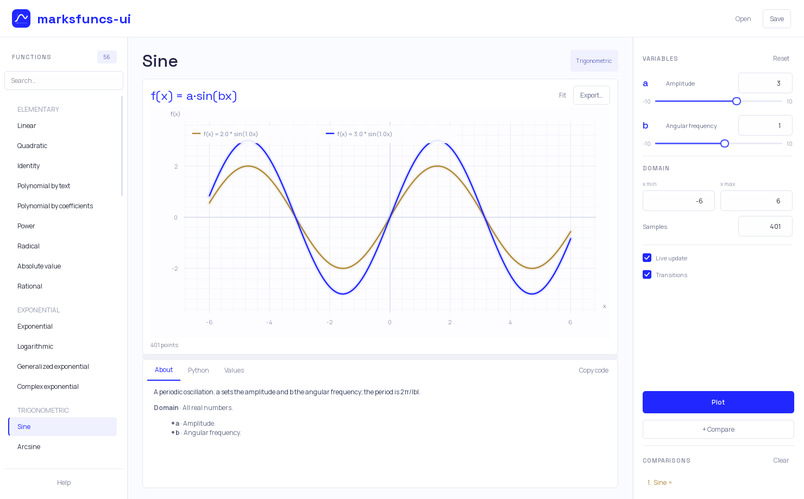
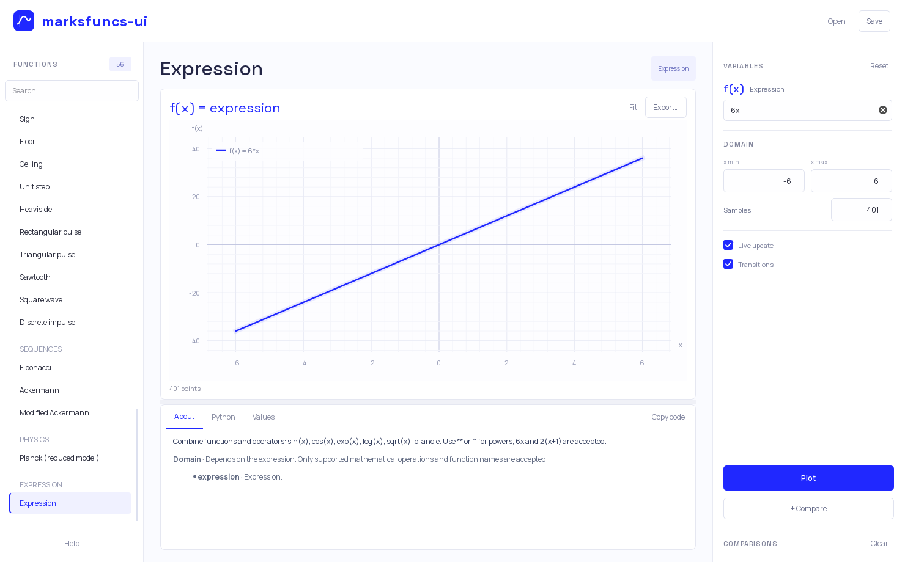

# marksfuncs-ui

A desktop interface for the [marksfuncs](https://github.com/marc1fino/marksfuncs) Python library.



[Compact layout](docs/compact-blue.png)

## Run

```powershell
py -3.12 -m venv .venv
.\.venv\Scripts\python -m pip install -e .
.\.venv\Scripts\python -m marksfuncs_ui
```

After activating the environment, `marksfuncs-ui` and `mfui` are also available. `./run.ps1` uses the project environment directly. Python 3.11 or later is required; development and tests use Python 3.12 on Windows. To install the recorded dependency versions, use `python -m pip install -r requirements-lock.txt` in the environment.

## Features

- Searchable function catalog with formulas, parameter descriptions and domain notes.
- Linked sliders and numeric inputs, editable expressions, sampling range and live updates.
- Animated plots with pan, cursor-centered zoom and up to four pinned comparisons.
- Python, PNG and CSV export; `.mfuncs` sessions preserve parameters, sampling and comparisons.

Space Grotesk is used for headings and Manrope for controls. Both fonts are bundled. Animations can be disabled.

## Where marksfuncs runs

[`compute_curve()` in engine.py](src/marksfuncs_ui/engine.py) resolves the installed class from `marksfuncs.functions`, validates its arguments and calls:

```python
library_function = library_class(**arguments)
library_function.graph()
```

The library performs the calculations and creates its Matplotlib plot. The interface copies those plotted samples into [`PlotWidget`](src/marksfuncs_ui/plot_widget.py) for Qt rendering, animation and camera interaction. It does not implement replacement function formulas or a separate expression evaluator. Complex components, scatter values and nonfinite samples come from the library unchanged.

The Python tab shows the same constructor arguments. Python and CSV exports contain the active function; PNG includes the visible comparisons. The table previews up to 400 rows; CSV includes every sample. Zoom changes the view; edit the sampling range to calculate a different domain.

## Expressions and library limitations

Use expressions such as `6x`, `2(x+1)`, `sin(x) + 0.2*x**2` or `sqrt(x)`. Implicit multiplication is converted to `*` before calling marksfuncs; the Python tab shows the converted expression. Powers accept `**` or `^`; `ln(x)` is an alias for `log(x)`. Expressions are checked before being passed to marksfuncs; imports, object access and arbitrary code are rejected.



marksfuncs 1.2 or later is required. All 56 catalog functions can be plotted, including `SineFresnel` and `CosineFresnel`. Upstream quirks are documented in the function descriptions: the classic polynomial parser can add unexpected constants, Ackermann colors can be paired with the wrong coordinates, and Planck uses a reduced model. The interface preserves these library results.

Existing version 1 `.mfuncs` files keep the same format and parameter keys. Session files are validated before loading and saved atomically.

## Shortcuts

| Shortcut | Action |
| --- | --- |
| Ctrl+F | Search |
| Ctrl+Enter | Plot |
| Ctrl+R | Reset parameters and sampling |
| Ctrl+0 / double-click plot | Reset view |
| Ctrl+S / Ctrl+O | Save / open session |
| F1 | Help |

## Verification

```powershell
.\.venv\Scripts\python -m unittest discover -s tests -v
.\.venv\Scripts\python -m compileall -q src tests
.\.venv\Scripts\python -m pip check
.\.venv\Scripts\python -m pip wheel --no-deps . --wheel-dir dist
```

Tests cover real-library data, expressions, exports, session preservation, numeric input, comparisons and compact layouts. Qt interface tests run offscreen. The wheel includes fonts and licenses and requires Python; it is not a standalone executable.

MIT license. Bundled fonts use the SIL Open Font License; their license files are in `src/marksfuncs_ui/assets/fonts/`.
