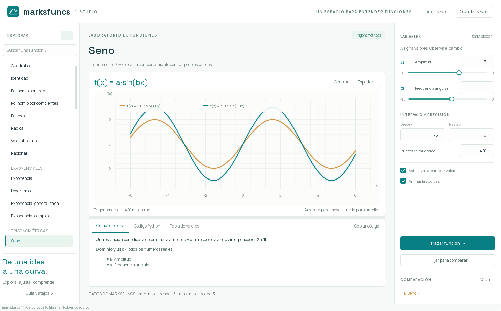

# marksfuncs · laboratorio visual

Aplicación de escritorio para explorar la librería Python [marksfuncs](https://github.com/marc1fino/marksfuncs).



Un espacio claro con acentos verde petróleo, fuentes incluidas y animaciones de trazado. Inspirado en [marksgeometrys-ui](https://github.com/marc1fino/marksgeometrys-ui), con una distribución diseñada para trabajar con funciones.

## Instalación

```powershell
py -3.12 -m venv .venv
.\.venv\Scripts\python -m pip install -e .
.\.venv\Scripts\python -m marksfuncs_ui
```

También puedes utilizar el comando `marksfuncs-ui` o `mfui` después de activar el entorno virtual.

Desde este directorio y con el entorno instalado, `./run.ps1` inicia la aplicación. Para reproducir las versiones verificadas en Windows con Python 3.12, instala con `python -m pip install -r requirements-lock.txt` dentro del entorno virtual. El código requiere Python 3.11 o posterior; la verificación se ha realizado con Python 3.12.

## Explora y asigna variables

- Catálogo con búsqueda, categorías y explicación en español de las 56 clases de la librería.
- Parámetros con deslizadores y entrada numérica precisa hasta ocho decimales, además de expresiones y coeficientes de polinomios.
- Intervalo de x y número de muestras editables; actualización automática opcional.
- Gráfica con desplazamiento, zoom centrado en el cursor, lectura de coordenadas y animaciones que se pueden desactivar.
- Hasta cuatro curvas fijadas junto a la función activa. Cambiar de función conserva sus parámetros durante la sesión.
- Pestañas de explicación, código Python reproducible y muestras de la librería.
- Exportación de la vista como PNG, de todas las muestras activas como CSV y del código activo como `.py`.
- Sesiones `.mfuncs` que guardan variables, intervalos, precisión y comparaciones. Se pregunta antes de descartar cambios; el guardado es atómico.

El código exportado utiliza asignaciones de variables y los mismos argumentos de constructor que la interfaz. La exportación Python y CSV corresponde a la función activa; el PNG incluye las comparaciones visibles. La tabla muestra hasta 400 filas; el CSV incluye todas las muestras.

Para expresiones, usa sintaxis como `sin(x) + 0.2*x**2`, `exp(-x)*cos(x)` o `sqrt(x)`. Las potencias utilizan `**`. En polinomios por coeficientes, `[1, 2, 3]` representa `1 + 2x + 3x²`; `{0: -1, 2: 2.5}` también es válido. El campo de polinomio clásico utiliza la sintaxis original `2x^3 - x + 1`.

## Los cálculos pertenecen a marksfuncs

La aplicación instancia las clases reales de `marksfuncs.functions` y ejecuta sus métodos `graph()`. Captura los datos que la librería entrega a Matplotlib y los dibuja con Qt, sin sustituirlos por fórmulas propias ni modificar la instalación de la librería. Se preservan las dos partes de la exponencial compleja y los valores de color originales de Ackermann. Las muestras no finitas dejan huecos; los fallos de origen se muestran en la interfaz.

Matplotlib usa el backend Agg y cada figura temporal se cierra después de copiar sus datos. Las operaciones se ejecutan en el hilo de Qt, se agrupan las ediciones rápidas y se limita el muestreo a 4000 puntos. Los parámetros tienen intervalos definidos en el catálogo; los algoritmos recursivos tienen límites adicionales para evitar bloquear la aplicación. Las expresiones se validan mediante AST antes de entregarlas a la librería: no se admiten acceso a objetos, importaciones ni código arbitrario.

El catálogo comprueba las capacidades de la librería instalada. Con marksfuncs 1.1 hay 54 clases que dibujan y dos clases Fresnel declaradas sin `graph()` ni `image()`: sus explicaciones se muestran, pero su cálculo queda desactivado.

También se documentan particularidades del código original:

- `Polynomial` puede añadir constantes inesperadas durante el análisis. Para controlar cada coeficiente utiliza `PolynomialCoefficients`.
- `Ackermann` aplana su matriz de valores en un orden distinto al de la malla de coordenadas; la correspondencia entre color y par puede ser incorrecta. La interfaz conserva esa salida y avisa en la explicación.
- `Planck` calcula un factor reducido con unidades normalizadas, sin el prefactor completo de radiancia.
- `DiracDelta` coloca un impulso discreto en la muestra central del intervalo.
- `ModifiedAckermann` exige `n`, aunque su método de dibujo no lo utiliza. Su intervalo está limitado a 0–20.
- `Poisson` evalúa con `linspace`: para muestrear enteros utiliza límites enteros y `puntos = fin − inicio + 1`.

El zoom cambia la cámara; para calcular sobre un dominio distinto hay que editar el intervalo. Los extremos mostrados son mínimos y máximos de las muestras, no resultados analíticos.

## Atajos

| Atajo | Acción |
| --- | --- |
| Ctrl+F | Buscar funciones |
| Ctrl+Enter | Trazar con los valores escritos |
| Ctrl+R | Restablecer parámetros e intervalo de la función activa |
| Ctrl+0 | Centrar la gráfica |
| Ctrl+S / Ctrl+O | Guardar / abrir sesión |
| F1 | Guía |
| Doble clic en la gráfica | Restablecer la vista |

## Verificación y distribución

```powershell
.\.venv\Scripts\python -m unittest discover -s tests -v
.\.venv\Scripts\python -m compileall -q src tests
.\.venv\Scripts\python -m pip check
.\.venv\Scripts\python -m pip wheel --no-deps . --wheel-dir dist
```

59 pruebas verifican procedencia de datos, las 54 funciones implementadas, errores de dominio, expresiones, exportación reproducible, valores complejos, dispersión, sesiones atómicas, entradas numéricas pendientes, comparación, navegación y diseño a 1080 × 720. Las pruebas de interfaz utilizan Qt offscreen y eventos de teclado y ratón de Qt. Se revisaron capturas a 1480 × 920 y 1080 × 720. El puente de automatización de ventanas de Windows no estuvo disponible; queda pendiente la comprobación manual con ratón y teclado en una ventana nativa. El wheel contiene los recursos y las licencias de las fuentes; requiere un intérprete Python y no es un ejecutable autónomo.

## Estructura

| Archivo | Responsabilidad |
| --- | --- |
| `catalog.py` | Clases, fórmulas, explicaciones y parámetros |
| `engine.py` | Validación, llamadas a marksfuncs y generación de código |
| `controls.py` | Edición visual de variables e intervalos |
| `plot_widget.py` | Gráfica animada e interacción de cámara |
| `main_window.py` | Navegación, comparación y exportación |
| `session.py` | Formato de sesión y guardado atómico |
| `details.py` | Explicaciones, código y tabla |
| `theme.py` | Estilo y tipografías incluidas |

Licencia MIT. Manrope y Space Grotesk se distribuyen con sus licencias SIL Open Font License en `assets/fonts/`.
